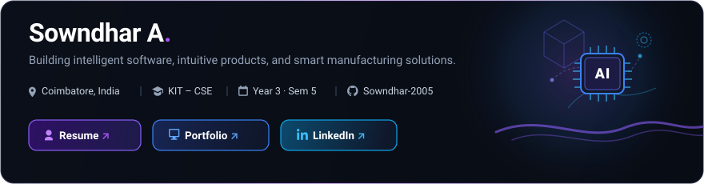
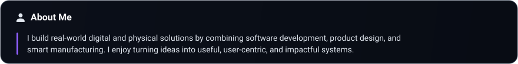
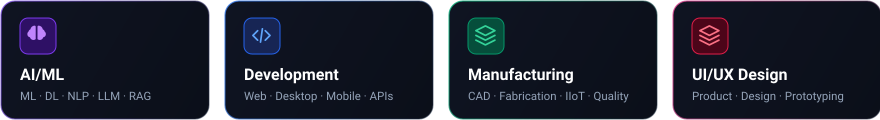
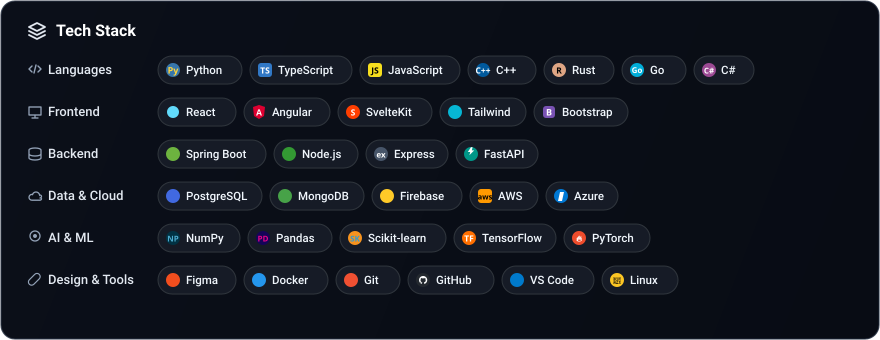
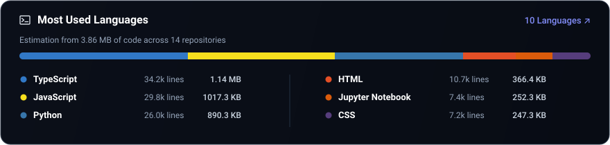
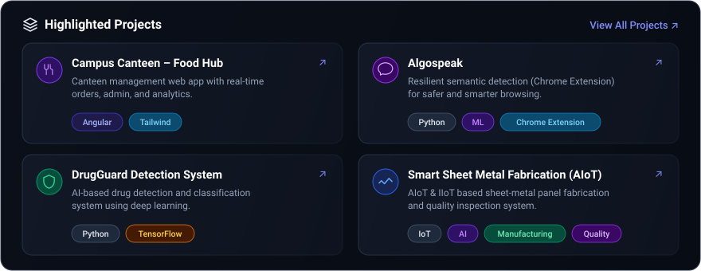
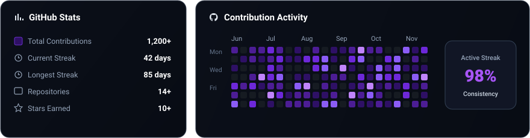

  <!-- ==================== HEADER BANNER ==================== -->
  

    

  <!-- Interactive Quick Links & Contact Badges -->
  

    
    &nbsp;
    
    &nbsp;
    
    &nbsp;
    
  

   

  <!-- ==================== ABOUT ME ==================== -->
  

    

  <!-- 4 Pillars of Expertise -->
  

    

  <!-- ==================== TECH STACK ==================== -->
  

    

  <!-- ==================== MOST USED LANGUAGES (DYNAMIC SYNC) ==================== -->
  

    

  <!-- ==================== HIGHLIGHTED PROJECTS ==================== -->
  

 

### 🚀 Featured Engineering Projects

<table>
  <tr>
    <td width="50%" valign="top">
      <h4><a href="https://github.com/Sowndhar-2005/Campus-Canteen">🍔 Campus Canteen – Food Hub</a></h4>
      
<b>TypeScript • Angular • Tailwind CSS • MEAN Stack</b>

      
Digitized campus canteen ordering and administrative workflow. Features real-time menu management, dynamic order tracking, role-based access for students and canteen staff, and live analytics.

    </td>
    <td width="50%" valign="top">
      <h4><a href="https://github.com/Sowndhar-2005/DrugGuard-Detection-System">🛡️ DrugGuard Detection System (Algospeak Resilient)</a></h4>
      
<b>Python • FastAPI • RapidOCR • Naive Bayes • Chrome Extension</b>

      
Real-time browser content safety extension. Detects obfuscated "algospeak" and illicit substance references in both raw DOM text and rendered image banners using OCR with client-side visual blurring.

    </td>
  </tr>
  <tr>
    <td width="50%" valign="top">
      <h4><a href="https://github.com/Sowndhar-2005/MAHORAGA">🧠 MAHORAGA — DNN Intrusion Detection & Adaptive Honeypot</a></h4>
      
<b>Python • Deep Neural Networks • Network Security • Deception Tech</b>

      
Cybersecurity engine combining deep neural network packet classification with an adaptive honeypot response. Converts detected attack vectors into active decoys to study threat actors in real-time.

    </td>
    <td width="50%" valign="top">
      <h4><a href="https://github.com/Sowndhar-2005">🏭 Smart Sheet Metal Fabrication (AIoT & IIoT)</a></h4>
      
<b>IoT / IIoT • Computer Vision • Quality Inspection • Smart Manufacturing</b>

      
Industrial IoT architecture connecting sensor telemetry on sheet-metal fabrication lines with computer-vision defect inspection to automate quality validation and reduce material scrap.

    </td>
  </tr>
  <tr>
    <td width="50%" valign="top">
      <h4><a href="https://github.com/Sowndhar-2005/Student-Performance-Analysis-Dashboard">📊 Student Performance Analysis & Mark Predictor</a></h4>
      
<b>Python • Streamlit • Scikit-Learn • Pandas • EDA</b>

      
End-to-end data science application that cleans raw academic telemetry, conducts exploratory trend analysis, and utilizes predictive regression models to forecast exam scores based on study habits.

    </td>
    <td width="50%" valign="top">
      <h4><a href="https://github.com/Sowndhar-2005/Eagle-Vision-">👁️ Eagle Vision — AI Internal Mobility Platform</a></h4>
      
<b>TypeScript • Recommendation Systems • Talent Analytics</b>

      
Enterprise AI platform identifying hidden talent within organizations. Normalizes disparate skill taxonomies, maps internal project opportunities, and outlines personalized learning paths.

    </td>
  </tr>
</table>

 

  <!-- ==================== WAKATIME LIVE TELEMETRY ==================== -->
  

  <!-- Live Dynamic Fallback / Cloud Card from WakaTime API -->
  

    
  

  <!-- WakaTime Automated Action Marker -->
  <!--START_SECTION:waka-->
  <!--END_SECTION:waka-->

    

  <!-- ==================== GITHUB STATS & STREAK ==================== -->
  

    

  <!-- Real-Time GitHub API Live Widgets -->
  

    
    &nbsp;
    
  

 

---

  
<b>⚡ Continuous Learner • AI/ML Explorer • Full-Stack Builder</b>

  

    <i>"Build consistently. Learn deeply. Make things that matter."</i>
  

  

    <a href="https://github.com/Sowndhar-2005">GitHub Profile</a> •
    <a href="https://www.linkedin.com/in/sowndhar-dev/">LinkedIn</a> •
    <a href="mailto:asowndhar2005@gmail.com">Get in Touch</a>
  

